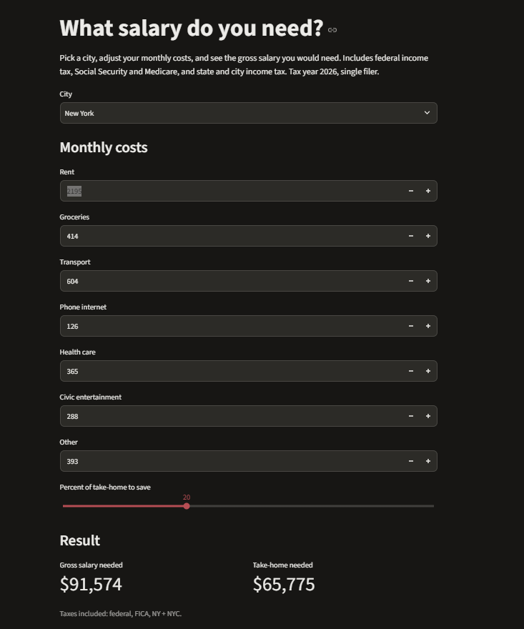
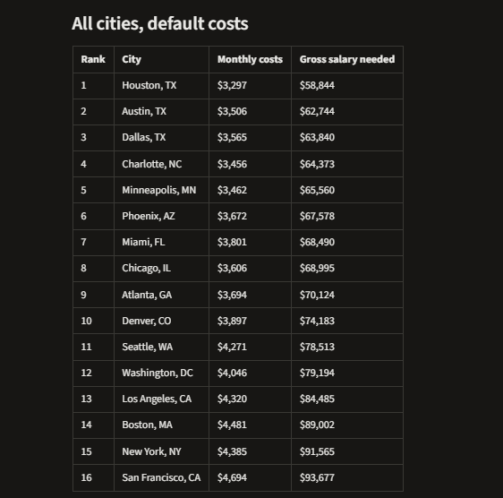

# Income Calculator: what salary do you need in each city?

An interactive calculator that answers one question: **what gross salary does a single person need to cover a basic budget, and save part of their paycheck, in each of 16 US cities?**

It combines real cost data from the MIT Living Wage Calculator with tax rules for 2026 (federal, Social Security and Medicare, state, and New York City), then solves backwards from the take-home pay you need to the salary you'd have to earn.




## What I found

With a 20% savings goal and basic-needs budgets, the salary needed ranges from about **$58,800 in Houston** to about **$93,700 in San Francisco**, roughly 1.6 times as much. New York (about $91,600) and Boston (about $89,000) are close behind. The four cheapest cities are Houston, Austin, Dallas, and Charlotte.

| Rank | City | Monthly costs | Gross salary needed |
|---|---|---|---|
| 1 | Houston, TX | $3,297 | $58,844 |
| 2 | Austin, TX | $3,506 | $62,744 |
| 3 | Dallas, TX | $3,565 | $63,840 |
| 4 | Charlotte, NC | $3,456 | $64,373 |
| 5 | Minneapolis, MN | $3,462 | $65,560 |
| 6 | Phoenix, AZ | $3,672 | $67,578 |
| 7 | Miami, FL | $3,801 | $68,490 |
| 8 | Chicago, IL | $3,606 | $68,995 |
| 9 | Atlanta, GA | $3,694 | $70,124 |
| 10 | Denver, CO | $3,897 | $74,183 |
| 11 | Seattle, WA | $4,271 | $78,513 |
| 12 | Washington, DC | $4,046 | $79,194 |
| 13 | Los Angeles, CA | $4,320 | $84,485 |
| 14 | Boston, MA | $4,481 | $89,002 |
| 15 | New York, NY | $4,385 | $91,565 |
| 16 | San Francisco, CA | $4,694 | $93,677 |

Cities with no state income tax (Texas, Florida, Washington) have the lowest tax cost. Taxes alone add about $10,600 to the New York salary, because it has both a state and a city income tax.

## How it works

1. Costs for the chosen city (rent, groceries, transport, and so on) are added up and multiplied by 12.
2. A savings percentage is applied to get the **take-home pay needed**.
3. The program works backwards to the **gross salary** that leaves that much after federal income tax, Social Security and Medicare, and state and city income tax. Taxes are not a simple percentage, so it solves for the salary with a binary search.

## How I checked it

I fed MIT's own cost figures into my tax engine and compared the required salary with the "required income before taxes" MIT publishes for each metro. For 15 of 16 cities the results are within **1.4%** of MIT's. New York is 6.9% higher because my model adds the NYC city income tax and MIT's metro-wide figure does not; with state tax only, it is within 1.5%. `check_states.py` also prints state tax on a $100,000 salary for each state, which I verified by hand against the published rate schedules.

## Run it yourself

```
pip install -r requirements.txt
python setup_db.py
python -m streamlit run app.py
```

`setup_db.py` builds a local SQLite database (`calculator.db`) from the data files. The database is not stored in the repo, because it is rebuilt from `tax_data.py` and `city_data.py` each time.

## Project structure

| File | What it does |
|---|---|
| `tax_data.py` | Federal brackets, standard deduction, Social Security cap, and state and city tax rules |
| `city_data.py` | Yearly costs for each city, with the source |
| `setup_db.py` | Builds the SQLite database from the two data files |
| `tax.py` | Tax calculations and the backwards solve for gross salary |
| `cities.py` | SQL queries for city costs and for each city's total (uses `JOIN` and `GROUP BY`) |
| `calculator.py` | The salary calculation used by the app |
| `app.py` | The Streamlit web app |
| `costs.py`, `compare.py` | Command-line versions: one city, or all cities ranked |
| `check_states.py` | Prints state tax on $100,000 for a quick check |

## Data sources

- **Costs:** [MIT Living Wage Calculator](https://livingwage.mit.edu), one adult with no children, metro-area pages, data updated Feb 15, 2026. Yearly amounts are divided by 12. MIT's categories map to mine: Housing is rent, Food is groceries, Transportation is transport, Internet & Mobile is phone and internet, Medical is health care, Civic is civic and entertainment, and Other is other.
- **Federal tax:** IRS 2026 brackets and standard deduction; Social Security wage base from the Social Security Administration ($184,500).
- **California:** Franchise Tax Board, Tax News, October 2026.
- **New York and NYC:** NYS Department of Taxation and Finance, Form IT-2105-I (2026).
- **Illinois, Georgia, North Carolina:** each state's Department of Revenue.
- **Minnesota:** Minnesota Department of Revenue, 2026 tax rates and deductions.
- **Massachusetts:** Massachusetts DOR, draft 2026 Form 1.
- **Washington, DC:** DC Office of Tax and Revenue, 2025 D-40 booklet.
- **Colorado, Arizona, Texas, Florida, Washington:** cross-checked against the Tax Foundation's 2026 state income tax rates.

## Limitations

- **Single filer only,** with wage income only, for the full year 2026. No married-filing or children (MIT has data for 12 household types, which would be a natural extension).
- **MIT budgets are basic-needs baselines.** They don't include eating out, leisure travel, or savings. The app lets you raise any cost.
- **MIT figures cover the whole metro area, not just the city.** For example, New York rent reflects the wider metro including suburbs, so rents in the city itself run higher.
- **Pre-tax deductions are not modeled** (401(k), pre-tax health insurance), and neither are tax credits other than California's personal credit.
- **Some state details are simplified or assumed:**
  - Arizona's 2026 standard deduction is assumed to follow the federal $16,100, since the state hadn't published its 2026 figure.
  - DC uses its 2025 standard deduction of $15,000, because I couldn't find a published 2026 amount.
  - New York's recapture rule (above $107,650 of income) is not modeled.
  - NYC school tax credits (roughly $260 at these incomes) are not modeled.
  - Massachusetts rent and Social Security deductions are not modeled.
  - Denver's flat city head tax (about $69 a year) is not modeled.
  - Colorado can temporarily lower its rate in surplus years under TABOR.
  - State payroll programs that aren't income tax (such as California disability insurance or Washington's long-term care premium) are not included.
- This is an educational estimate, not tax advice.

## Ideas for next steps

- Couples and families, using MIT's other household types
- A job-offer comparison ("$85,000 in Boston versus $75,000 in Atlanta: what's left after taxes and costs?")
- A live hosted version of the app